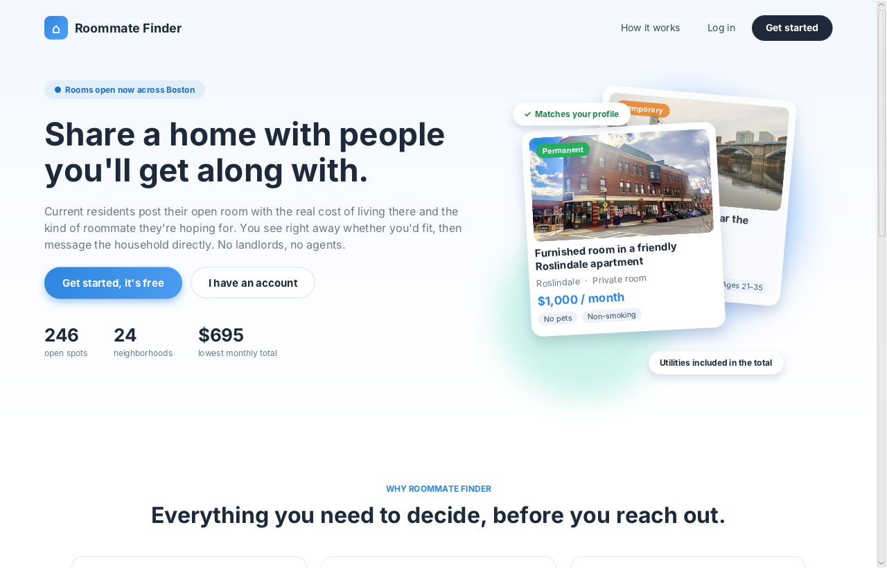
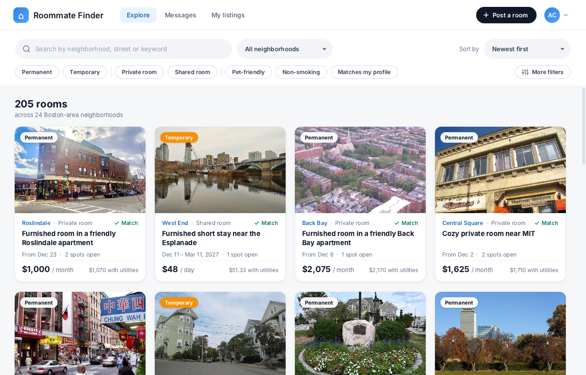
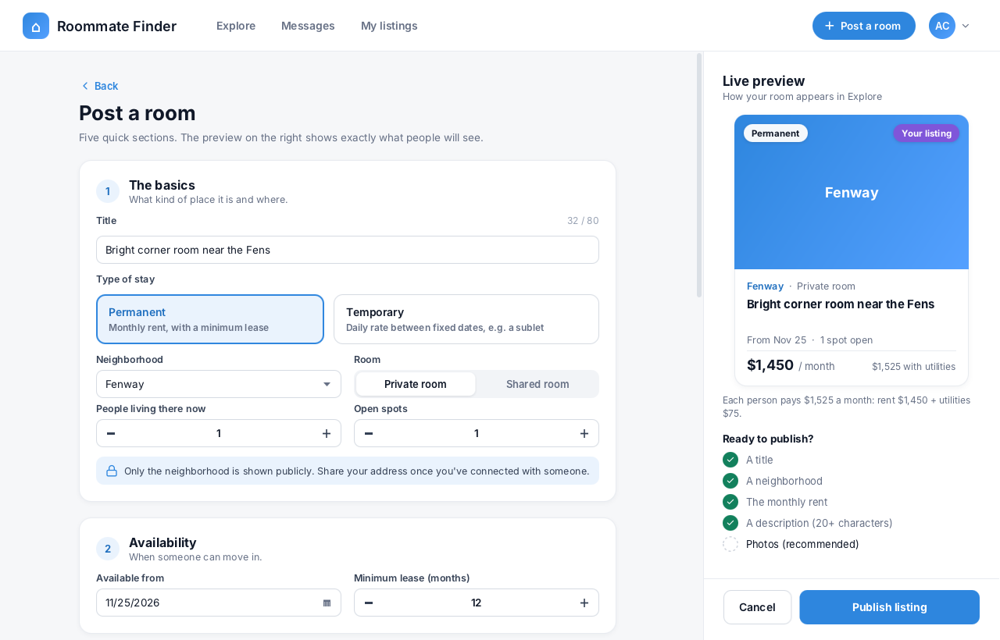
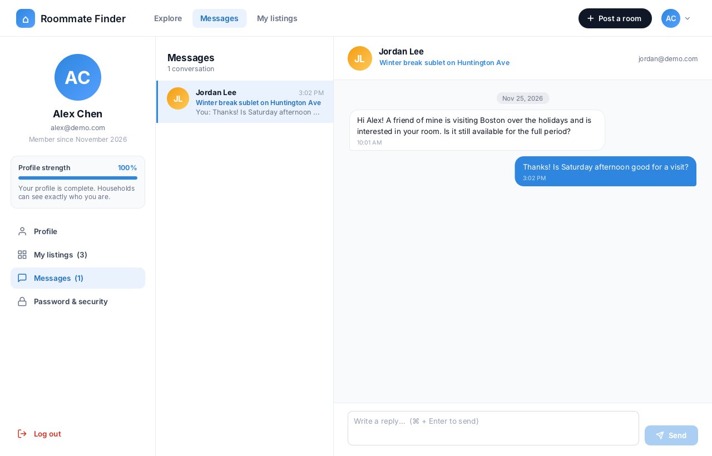
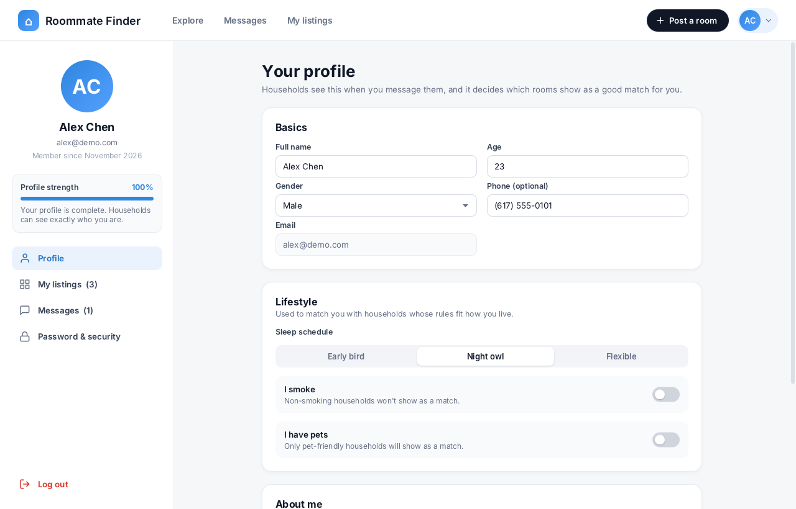
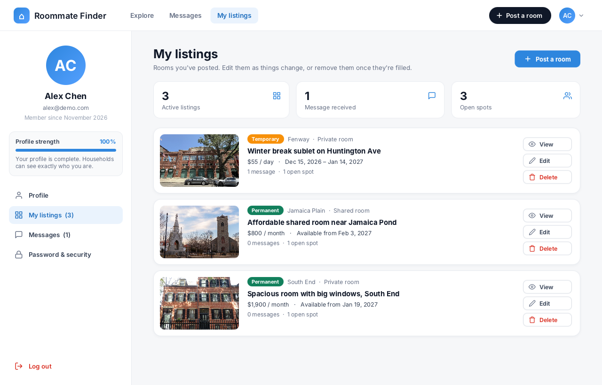
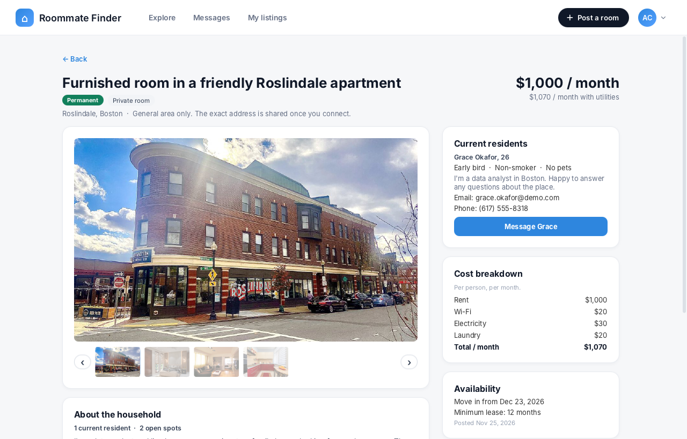

# Roommate Finder

A JavaFX desktop app for people who already have a place and want to fill an open spot in it. Current residents post their spare room with an honest cost breakdown and the kind of roommate they're looking for. People searching can filter by budget, dates and lifestyle, see right away whether they'd fit, and message the household directly. No landlords or agents are involved.

Built with Java and JavaFX. It started as a project for CSYE 6200 (Concepts of Object-Oriented Design) at Northeastern University.



## Features

**Welcome page**
- A landing page shown before login: what the app does, how it works, and live numbers (open spots, neighborhoods, lowest monthly total) with a preview of the newest listings, all taken from the app's real data.
- "Get started" goes to registration and "Log in" to the login screen. Logging out brings you back here.

**Accounts**
- Register with email, password and a lifestyle profile (age, gender, smoking, pets, sleep schedule).
- Passwords are stored only as salted PBKDF2-HMAC-SHA256 hashes and compared in constant time.
- An account menu behind your avatar (top right) holds your name, profile pages and **Log out**.
- The profile area has a sidebar with your avatar, a profile-strength meter that tells you what's missing, and sections for your profile, your listings, messages, and password.

**Posting a room**
- Permanent rooms (monthly rent, minimum lease) or temporary stays (daily rate, start and end dates).
- A five-step form with a **live preview** beside it: the card updates as you type, exactly as it will appear in Explore, with the per-person total and a "ready to publish" checklist.
- Current residents and open spots, plus per-person Wi-Fi, electricity and laundry costs.
- Up to 10 photos: drag them in or browse, and pick which one is the cover. Files are copied into the app's own data folder, so they still show if the originals move.
- Household preferences: pet-friendly, smoking, gender preference and an age range.
- Validation on every field, with all problems listed together. You can edit or delete your own posts later.

**Browsing and filtering**
- Photo-first card grid that resizes its columns to fit the window, with search (title, neighborhood, description), a neighborhood picker and sorting (newest, price, soonest available, most spots). Cards load 24 at a time with a "Show more" button, so 200+ photo listings stay fast.
- One-click filter chips that apply instantly: permanent or temporary, private or shared room, pet-friendly, non-smoking, and "Matches my profile", which checks each listing's preferences against your profile.
- A "More filters" panel for the rest: monthly budget range, move-in and move-out dates, maximum monthly utilities for permanent rooms and maximum total daily cost for temporary stays.
- Cards mark the listings you match; the details page explains any mismatch.

**Household details and contact**
- Photo gallery, the general neighborhood only (never an exact address), household description, roommate criteria, a full cost breakdown and availability.
- Contact details for the residents and a **Message** button. Messages arrive under **Messages**, shown as conversations (one per person and listing) with chat bubbles and an inline reply box.



| Creating a post (live preview) | Messages |
|---|---|
|  |  |

| Profile | My listings | Listing details |
|---|---|---|
|  |  |  |

## Running it

**Requirements:** JDK 21 or newer, and the [JavaFX SDK](https://gluonhq.com/products/javafx/) 21 or newer. It was developed with JavaFX 23.0.1.

### Command line (macOS / Linux)

```bash
JAVAFX_HOME=/path/to/javafx-sdk-23.0.1 ./run.sh
```

The script compiles everything into `out/`, copies the FXML, CSS and images, and launches the app.

### Eclipse

1. **File → Import → Existing Projects into Workspace** and select this folder.
2. **Window → Preferences → Java → Build Path → User Libraries → New…**, name it `JavaFX`, and add every `.jar` from `javafx-sdk/lib`.
3. Run `application.Main` with these VM arguments:
   ```
   --module-path "/path/to/javafx-sdk/lib" --add-modules javafx.controls,javafx.fxml
   ```

### Demo accounts

The first launch creates 24 demo hosts and 205 listings across 24 Boston-area neighborhoods, each with a neighborhood photo and room photos, plus a sample message. You can sign in as any of these:

| Email | Password |
|---|---|
| `alex@demo.com` | `password123` |
| `priya@demo.com` | `password123` |
| `jordan@demo.com` | `password123` |

You can also register a new account from the login screen.

## Project structure

```
src/
├── application/   Main entry point, Navigator (screen loading), FXML screens, styles.css
├── controller/    One controller per screen: Welcome, Login, Register, Shell (top bar), MainListingPage,
│                  NewPost, ListingDetails, Profile
├── model/         User, Listing (abstract), PermanentListing, TemporaryListing,
│                  HouseholdPreferences, Message, Searchable, enums
├── filter/        Filter<T>, CompositeFilter<T> and the concrete listing filters
├── service/       DataStore (persistence), PasswordHasher, Session, SampleData
├── ui/            Reusable view pieces: ListingCard, CoverImage, Photos, Avatar, Icons, Dialogs, Inputs
└── util/          Format (money and date display)
```

## Data storage

Everything is saved to `~/.roommatefinder/` after each change:

- `data.ser` holds all users, listings and messages, written atomically (to a temp file, then moved into place).
- `photos/` holds copies of uploaded listing photos, named by UUID.
- `sample-photos/` holds the demo listings' photos, copied from the app on first use. They are shared between listings, so they are never deleted automatically.

If `data.ser` can't be read, it is kept as `data.ser.bak` and the app starts again with fresh demo data. The demo data is versioned: when a newer version of the app has new demo data, it replaces the old demo listings on startup and keeps everything real users created. To reset completely, delete the folder. To use a different location, start the JVM with `-Droommatefinder.dataDir=/some/folder`.

The project plan suggested SQLite or MySQL. We used Java serialization instead so the app runs with no database server or extra dependencies. The data is organized like this:

| Entity | Key | Fields |
|---|---|---|
| **User** | email (lower-cased) | name, passwordHash (`iterations:salt:hash`), age, gender, phone, bio, smoker, hasPets, sleepSchedule, memberSince |
| **Listing** (abstract) | id (UUID) | ownerEmail → User, createdAt, title, description, location, roomType, currentResidents, openSpots, wifiCost, electricityCost, laundryCost, availableFrom, photoPaths, preferences |
| ↳ **PermanentListing** | | monthlyRent, minLeaseMonths |
| ↳ **TemporaryListing** | | dailyRate, availableUntil |
| **HouseholdPreferences** | embedded in Listing | petFriendly, smokingAllowed, genderPreference, minAge, maxAge (0 = no limit) |
| **Message** | stored per recipient | fromEmail, fromName, toEmail, listingId → Listing, listingTitle, text, sentAt |

In memory, `DataStore` keeps users in a `Map<String, User>`, listings in a `List<Listing>`, and each user's inbox in a `Map<String, List<Message>>`.

## Course concepts

| Concept | Where it's used |
|---|---|
| JavaFX | FXML screens in [`src/application`](src/application), controllers in [`src/controller`](src/controller), custom styling in [`styles.css`](src/application/styles.css) |
| Class definition | [`User`](src/model/User.java), [`Listing`](src/model/Listing.java), [`Message`](src/model/Message.java) (a record), [`HouseholdPreferences`](src/model/HouseholdPreferences.java) |
| Inheritance and polymorphism | [`PermanentListing`](src/model/PermanentListing.java) and [`TemporaryListing`](src/model/TemporaryListing.java) extend `Listing` and override pricing (`getMonthlyEquivalentCost`, `getPriceLabel`) and availability (`isAvailableFor`). Filters, sorting and cards treat every listing the same way. |
| Abstract classes and interfaces | `Listing` is abstract; [`Searchable`](src/model/Searchable.java) is used for keyword search; [`Filter<T>`](src/filter/Filter.java) is a functional interface for every search criterion |
| Generics | `Filter<T>`, [`CompositeFilter<T>`](src/filter/CompositeFilter.java), `Navigator.View<C>` (a loaded screen together with its typed controller) |
| Collections and iterators | `Filter.applyTo` walks any `Iterable<T>` with an explicit `Iterator`; enum value lists feed the combo boxes |
| Lists | All listings in `DataStore`; photo paths on each listing |
| Sets and maps | Users by email (`LinkedHashMap`); contact history as inboxes (`Map<String, List<Message>>`); a `HashSet` of photos still in use, for cleaning up removed ones |
| Recursion | `CompositeFilter` groups filters with AND/OR. Groups can contain other groups, and both `matches` and `criteriaCount` work through the tree recursively. |

## Credits

- Listing photos are freely licensed images from Wikimedia Commons. Authors and licenses are listed in [docs/PHOTO_CREDITS.md](docs/PHOTO_CREDITS.md).
- The interface uses the [Inter](https://rsms.me/inter/) typeface (SIL Open Font License, included in `src/fonts`).
